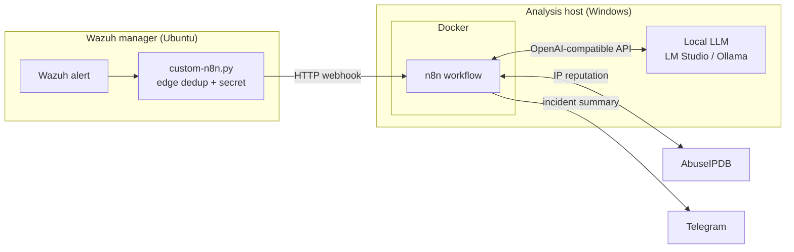

# Wazuh AI Triage

An n8n workflow that triages [Wazuh](https://wazuh.com) SIEM alerts with a **local LLM**.
Each alert is validated, deduplicated, enriched with threat intel, analysed by a model running
on your own GPU, checked against a strict JSON schema, given a priority, and sent to Telegram
as a short incident summary. No cloud AI and no subscriptions.

What leaves your network: the source IP (only public ones) goes to AbuseIPDB if you set a key,
and the notification goes to Telegram. The Telegram message contains the host name, user names,
IPs, the rule and the AI summary. Set `TELEGRAM_ENABLED=false` to keep everything local, or
`NOTIFY_REDACT=true` to hide host and user names. A local model does not make the whole system local.

> **Status:** MVP, for a lab. The workflow is tested end-to-end on a real n8n 2.45.6 against the
> mock services in [`tests/`](tests/) (in CI too). It has not yet been measured against a live Wazuh
> manager and a real model, and it should not be your only alert path. Blocking is dry-run only.

## What it does



| Step | Node | What happens |
| --- | --- | --- |
| 1 | `custom-n8n.py` (on Wazuh) | Wazuh runs it for every alert at or above a level. It deduplicates (see below), POSTs the alert with a shared secret, and keeps alerts it could not send in a spool folder to re-send later. |
| 2 | Wazuh Webhook | Receives the alert. |
| 3 | Sanitize & Validate | Checks the secret (fails closed: no secret configured means every request is refused), keeps only needed fields per alert family (FIM, Windows, network), strips control characters, caps lengths and records what was cut, parses IPv4/IPv6 properly and flags non-public and whitelisted IPs. |
| 4 | Acknowledge | Answers the HTTP request at once: `202` accepted, `400` not a Wazuh alert, `401` wrong secret, `503` secret not configured. `202` means "accepted for analysis", not "delivered". |
| 5 | Deduplicate | Second dedup layer (n8n static data, best effort). |
| 6 | AbuseIPDB Lookup | Only for public IPs and only when an API key is set. Failures never stop the pipeline. |
| 7 | Build LLM Request | Builds an OpenAI-compatible request with a JSON schema. Alert data is passed as delimited, untrusted data to resist prompt injection. |
| 8 | LLM Triage | Calls the local model (LM Studio, Ollama, vLLM, llama.cpp ...). |
| 9 | Parse & Score | Checks the answer against the same JSON schema (no type coercion). Sets the priority (see "Priority policy"), and a dry-run block recommendation. An invalid answer falls back to the Wazuh severity and never gets a block recommendation. |
| 10 | Send Telegram | Sends the summary, retrying 3 times. Can be turned off. |
| 11 | Result | Final record per alert. If Telegram failed, it fails the execution, so the error is visible and can be retried. |

Example message (sample 01 with a mocked model answer):

```
🟠 Wazuh AI triage: HIGH

Rule 5712 (level 10, high): sshd: brute force trying to get access to the system. Non existent user.
Agent: laptop (000)
Source IP: 203.0.113.45 (not public)
User: admin
AI: true_positive, high (model confidence 90, uncalibrated)
Risk score: 75/100 (heuristic)
MITRE: T1110 Brute Force

Repeated SSH logins for a non-existent user from one IP: a brute force attempt.

Recommended:
- Check whether any login from this IP succeeded
- Disable SSH password login

Action: none (source IP is not public)
Similar alerts suppressed before this one: 19
Time: 2026-10-29T18:12:44.512+0200
```

The samples use documentation addresses (TEST-NET), which are not public, so they never get an
AbuseIPDB lookup or a block recommendation. The end-to-end test uses a separate public test IP,
sent only to the local mock services.

## Security design

- **Shared secret, fail closed**: Wazuh sends `X-Wazuh-Token`; n8n compares it in constant time. If `WEBHOOK_SECRET` is empty, every request is refused with `503` instead of being accepted.
- **Network exposure**: port 5678 serves both the webhook and the n8n editor. Allow it only from the Wazuh manager's IP in the firewall (see [`docs/setup-he.md`](docs/setup-he.md)), or bind to `127.0.0.1` with `N8N_BIND`. Traffic is plain HTTP: fine on a home lab LAN, otherwise use a VPN (Tailscale, WireGuard) or a reverse proxy with TLS. Request bodies over 1 MB are refused.
- **Strict input validation**: IPv4/IPv6 addresses are parsed (not just pattern-matched), canonicalised, and classified with the IANA special-purpose ranges (private, loopback, link-local, multicast, documentation, benchmark, IPv4-mapped ...). Whitelist CIDRs work for both families. All strings are cleaned and length-capped.
- **Prompt injection guard**: log data goes to the model inside `<alert>` tags with an instruction to never follow text found there. This is one layer, not a guarantee. The second layer is that the answer is checked against the schema and cannot trigger any action by itself. Sample `04-prompt-injection-username.json` is there to try it.
- **Structured output, checked on arrival**: the server is asked for a JSON schema, and the reply is validated against the same schema (types, enums, ranges, lengths, no extra fields). `"false"` as text is not `false`.
- **Safe auto-block**: blocking is **dry-run only**. A block is suggested only for public, non-whitelisted IPs, with a valid answer, a `true_positive` verdict, the model's recommendation and a risk score over a valid threshold. No command is ever built from model output.
- **No secrets in the repo**: keys live in `.env` (git-ignored). CI runs gitleaks over the whole history.

## Priority policy

The workflow keeps three opinions apart and shows them all: the Wazuh rule level (`source_severity`),
the model's assessment, and AbuseIPDB. Then a fixed policy decides:

- **Priority** = the higher of the Wazuh severity and the model's severity. The model can raise a priority but never lower it below the Wazuh rule.
- If the model calls a high or critical Wazuh alert low or a false positive, the message says **NEEDS HUMAN REVIEW** instead of quietly downgrading it.
- **Risk score** (0-100) is a heuristic: 70% model severity (times 0.3 for a false positive) + 30% AbuseIPDB score. It only gates the dry-run block recommendation. It is not a probability of attack, and AbuseIPDB 0 does not mean innocent.
- The model's **confidence** is shown as reported. It is not calibrated and does not count as evidence.

## Deduplication

Two different questions, with the same rules on the Wazuh side and in n8n
(shared test cases in [`tests/fixtures/dedup_cases.json`](tests/fixtures/dedup_cases.json)):

- **Same alert again?** Key: manager + agent + Wazuh alert id. A re-delivery (for example a retry after a lost answer) is dropped and is *not* counted as a new event.
- **Similar alert in the window?** Key: manager + agent + rule + level + a subject that depends on the alert type: file path + event for file integrity (FIM), IP + user + logon type for Windows, source IP for the rest. Similar alerts inside `DEDUP_WINDOW_SECONDS` are dropped and counted.
- When there is no subject that tells events apart, alerts are **not** grouped. A duplicate message is better than a lost alert.

The count of dropped alerts is reported with the *next* alert of the same group that gets through,
which only happens if one arrives after the window. There is no timer that sends a summary on its
own, so after a burst of 50 the count may stay unreported until the attack repeats.

## Reliability

What is guaranteed and what is not, in this version:

- **Wazuh to n8n**: `custom-n8n.py` retries network errors, `429` and `5xx` with backoff and jitter. Answers that need a fix (`401` wrong secret, `404` workflow not published, `400`) are not retried right away. Either way, the alert is saved to `/var/ossec/logs/custom-n8n-spool/` and re-sent on later runs (30 s, 1 min, 2 min ... up to 1 h apart). After 50 tries or 3 days it moves to `spool/failed/` with an `ERROR` line in `integrations.log`. `sudo /var/ossec/integrations/custom-n8n --flush` re-sends everything now.
- **Inside n8n**: an accepted alert is analysed after the `202` answer. If n8n restarts in the middle, that alert is lost from this pipeline (it is still in Wazuh). n8n here is not a durable queue; making it one (n8n queue mode or an outbox) is on the roadmap.
- **Telegram**: 3 tries. If all fail, the execution is marked as failed, the optional error workflow runs, and you can retry the execution in n8n.
- **Delivery is at least once**, not exactly once: if n8n got an alert but its answer was lost, the replay is dropped by the event key, but a Telegram message whose answer was lost can arrive twice.
- **Capacity**: `N8N_CONCURRENCY_PRODUCTION_LIMIT=1` analyses one alert at a time. If one analysis takes 30 seconds, that is about 2 alerts per minute. Raise the Wazuh level or the dedup window if alerts pile up.

## Quick start

You need: a Wazuh manager, a machine with Docker and a local LLM server (for example
[LM Studio](https://lmstudio.ai) with its server on port 1234), and optionally a Telegram bot
and an AbuseIPDB key. A step-by-step guide in Hebrew is in [`docs/setup-he.md`](docs/setup-he.md).

**On the n8n machine:**

```bash
git clone https://github.com/sovietpanda1/wazuh-ai-triage.git
cd wazuh-ai-triage
cp .env.example .env          # then fill in .env
docker compose up -d          # n8n on http://localhost:5678
```

`WEBHOOK_SECRET` must be set, or the webhook refuses everything. In n8n, import
`workflows/wazuh-ai-triage.json` and publish it. Optionally import `workflows/error-alerts.json`
and select it as the error workflow in the triage workflow's settings.

Test without Wazuh:

```bash
python3 scripts/send_alert.py --all                                          # Linux / macOS
powershell -ExecutionPolicy Bypass -File scripts\send-alert.ps1              # Windows
```

**On the Wazuh manager:**

```bash
git clone https://github.com/sovietpanda1/wazuh-ai-triage.git
cd wazuh-ai-triage
sudo ./wazuh/install-integration.sh http://<n8n-host-ip>:5678/webhook/wazuh-alert 7
```

The installer backs up `ossec.conf` and any earlier integration files, copies the integration,
adds it to `ossec.conf`, restarts the manager, and restores everything if a step fails. If
`WEBHOOK_SECRET` is not set it keeps the secret of an earlier install, or generates and prints a
new one on the first install (`ROTATE_SECRET=1` forces a new one).

## Configuration

All settings are environment variables in `.env`:

| Variable | Default | Meaning |
| --- | --- | --- |
| `WEBHOOK_SECRET` | (empty) | **Required.** Shared secret (16+ characters), must match `<api_key>` in `ossec.conf`. Empty = every request is refused (`503`). |
| `N8N_BIND` | `0.0.0.0` | Address n8n listens on. `127.0.0.1` = this machine only. |
| `LLM_BASE_URL` | `http://host.docker.internal:1234/v1` | Any OpenAI-compatible server. Ollama: `http://host.docker.internal:11434/v1`. |
| `LLM_MODEL` | `qwen/qwen3.5-9b` | Model id as the server lists it (`/v1/models`). |
| `LLM_API_KEY` | `local` | Only needed if your server checks it. |
| `LLM_MAX_TOKENS` | `2048` | Longest answer the model may write. A cut-off answer counts as a failed analysis. |
| `ABUSEIPDB_API_KEY` | (empty) | Free key from abuseipdb.com. Empty skips the lookup. |
| `TELEGRAM_ENABLED` | `true` | `false` keeps results in n8n only (nothing goes to Telegram). |
| `TELEGRAM_BOT_TOKEN`, `TELEGRAM_CHAT_ID` | (empty) | From @BotFather and your chat with the bot. |
| `NOTIFY_REDACT` | `false` | `true` hides host and user names in the message. |
| `DEDUP_WINDOW_SECONDS` | `600` | n8n-side grouping window. The Wazuh side has its own (set by the installer). Invalid values fall back to 600. |
| `BLOCK_THRESHOLD` | `80` | Risk score (1-100) at which a block is suggested (dry-run). An invalid value turns block suggestions off and says so in the message. |
| `WHITELIST_CIDRS` | (empty) | Comma-separated IPv4/IPv6 addresses or CIDRs that must never be blocked. Invalid entries are reported in the message. |

`docker-compose.yml` sets `N8N_CONCURRENCY_PRODUCTION_LIMIT=1`, so alerts are analysed one at a
time. A single local GPU handles one request at a time anyway, and it keeps n8n's dedup state consistent.

The workflow reads its settings with `$env`, which is why the compose file sets
`N8N_BLOCK_ENV_ACCESS_IN_NODE=false`. That lets every Code node read every variable in `.env`,
so do not put unrelated secrets in that file.

## Project structure

```
docker-compose.yml          n8n service (the LLM runs on the host for GPU access)
.env.example                all settings, no secrets
workflows/                  n8n workflows (import these; generated, do not edit by hand)
workflows/src/              JavaScript of the Code nodes (edit these, then run scripts/build_workflow.py)
wazuh/                      Wazuh integration script, installer, ossec.conf snippet
samples/alerts/             realistic Wazuh alerts for testing, with expected labels
scripts/                    send sample alerts, build the workflow, evaluate a real model
tests/                      Python + JavaScript unit tests, end-to-end test, mock services
docs/setup-he.md            step-by-step setup guide (Hebrew)
```

## Testing

Three layers, each answering a different question:

```bash
# 1. Unit tests: does the logic do what it should?
python3 -m unittest discover -s tests -v       # Wazuh script, workflow checks (installer tests need sudo)
node --test "tests/js/*.test.js"                # Code node logic: IPs, dedup, schema check, priority

# 2. End-to-end: does the real workflow behave, wired together in a real n8n?
python3 tests/e2e/run_e2e.py --docker           # or without --docker if `n8n` is installed (Node 24)

# 3. Evaluation (optional, needs your model): how does a real model answer the samples?
node scripts/evaluate.js --base-url http://localhost:1234/v1 --model qwen/qwen3.5-9b
```

- `tests/test_integration.py`: dedup contract, bursts of 20 parallel copies, re-deliveries, the
  spool (failed sends kept, replayed, given up with an error), the `--flush` command.
- `tests/test_installer.py`: the installer in a fake Wazuh folder: keeps the secret, rolls back.
- `tests/js/`: each Code node from `workflows/src/`, run with a small stand-in for n8n's globals.
- `tests/e2e/run_e2e.py`: n8n 2.45.6 with `tests/mock_services.py` (fake LLM, AbuseIPDB, Telegram):
  401/400 answers, dedup, the AbuseIPDB and dry-run block path, a schema-breaking model answer,
  and a Telegram outage that must fail the execution.
- `scripts/evaluate.js`: runs `samples/labels.json` through a real model with the workflow's own
  code and reports schema validity, verdicts, severities and latency, with the model and prompt
  version. Six samples are a smoke test, not an accuracy figure. The mock is not a model: never use
  it to claim accuracy.

CI runs layers 1 and 2 and a gitleaks secret scan on every push.

## Roadmap

- [x] MVP: webhook, sanitization, two-layer dedup, AbuseIPDB, local LLM triage, risk score, Telegram
- [x] Fixes from the first code review: dedup contract, schema validation, fail-closed webhook, IP parsing, spool for failed sends, priority policy, end-to-end tests
- [ ] Live test with Wazuh + LM Studio (read-only pilot), tune the prompt, measure missed alerts and wrong recommendations
- [ ] Durable queue inside n8n (queue mode or an outbox) and a timed summary for suppressed counts
- [ ] More anonymised real alerts and injection cases for `scripts/evaluate.js`
- [ ] VirusTotal lookups for file hashes (FIM / malware alerts)
- [ ] Real auto-block through Wazuh Active Response, with an approve button in Telegram
- [ ] Incident report archive and vulnerability (CVE) reports
- [ ] TheHive / IRIS case creation

## License

MIT. This is an independent project, built from scratch for learning.
