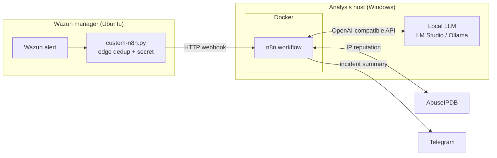

# Wazuh AI Triage

An n8n workflow that triages [Wazuh](https://wazuh.com) SIEM alerts with a **local LLM**.
Each alert is validated, deduplicated, enriched with threat intel, analysed by a model running
on your own GPU, given a 0-100 risk score, and sent to Telegram as a short incident summary.
No cloud AI, no subscriptions, and alert data never leaves your network (except the IP lookup).

> **Status:** MVP. The pipeline is tested end-to-end on n8n 2.45.6 against the mock services in
> [`tests/`](tests/). Testing against a live Wazuh manager and LM Studio is the next step.

## What it does



| Step | Node | What happens |
| --- | --- | --- |
| 1 | `custom-n8n.py` (on Wazuh) | Wazuh runs it for every alert at or above a level. It drops repeats of the same rule + agent + source IP inside a cooldown window (file-locked, safe for bursts) and POSTs the alert with a shared secret. |
| 2 | Wazuh Webhook | Receives the alert. |
| 3 | Sanitize & Validate | Rejects requests without the secret, keeps only needed fields, strips control characters, caps lengths, strictly validates IPs, flags private and whitelisted IPs. |
| 4 | Deduplicate | Second dedup layer (n8n static data). Counts suppressed repeats, so 50 alerts become 1 message that says "49 suppressed". |
| 5 | AbuseIPDB Lookup | Only for public IPs and only when an API key is set. Failures never stop the pipeline. |
| 6 | Build LLM Request | Builds an OpenAI-compatible request with a JSON schema. Alert data is passed as delimited, untrusted data to resist prompt injection. |
| 7 | LLM Triage | Calls the local model (LM Studio, Ollama, vLLM, llama.cpp ...). |
| 8 | Parse & Score | Parses the verdict, severity, MITRE technique and next steps. Combines AI severity (70%) and AbuseIPDB score (30%) into a 0-100 risk score. Falls back to the Wazuh level if the model fails. |
| 9 | Send Telegram | Sends the summary. |
| 10 | Result | Final record per alert, visible in n8n's execution history. |

Example message (from the mock test run):

```
🟠 Wazuh AI triage: HIGH (risk 83/100)

Rule 5712 (level 10): sshd: brute force trying to get access to the system. Non existent user.
Agent: laptop (000)
Source IP: 203.0.113.45 | AbuseIPDB 100% (1342 reports, NL)
User: admin
Verdict: true_positive (confidence 90%)
MITRE: T1110 Brute Force

Repeated SSH logins for a non-existent user from one public IP: a brute force attempt.

Recommended:
- Block the source IP
- Disable SSH password login

Action: would block 203.0.113.45 (dry-run)
Duplicates suppressed: 19
```

## Security design

- **Shared secret** between Wazuh and n8n (`X-Wazuh-Token`), so random requests to the webhook are ignored.
- **Strict input validation**: only well-formed IPv4/IPv6 addresses pass, all strings are cleaned and length-capped. This matters before any future automated response step.
- **Prompt injection guard**: log data goes to the model inside `<alert>` tags with an instruction to never follow text found there. Sample `04-prompt-injection-username.json` tests this.
- **Structured output**: the model must answer with a fixed JSON schema; anything else is treated as a failed analysis.
- **Safe auto-block**: blocking is **dry-run only** in this version. A block is suggested only for public, non-whitelisted IPs when the model recommends it and the risk score is above the threshold.
- **No secrets in the repo**: all keys live in `.env` (git-ignored). CI fails if a workflow file looks like it contains a key.
- **Local AI**: alert content is only sent to a model on your own machine.

## Quick start

You need: a Wazuh manager, a machine with Docker and a local LLM server (for example
[LM Studio](https://lmstudio.ai) with its server on port 1234), and optionally a Telegram bot
and an AbuseIPDB key. A step-by-step guide in Hebrew is in [`docs/setup-he.md`](docs/setup-he.md).

**On the n8n machine:**

```bash
git clone https://github.com/sovietpanda1/wazuh-ai-triage.git
cd wazuh-ai-triage
cp .env.example .env          # then fill in .env
docker compose up -d          # n8n on http://localhost:5678
```

In n8n, import `workflows/wazuh-ai-triage.json` and publish it. Optionally import
`workflows/error-alerts.json` and select it as the error workflow in the triage workflow's settings.

Test without Wazuh:

```bash
python3 scripts/send_alert.py --all                                          # Linux / macOS
powershell -ExecutionPolicy Bypass -File scripts\send-alert.ps1              # Windows
```

**On the Wazuh manager:**

```bash
git clone https://github.com/sovietpanda1/wazuh-ai-triage.git
cd wazuh-ai-triage
sudo ./wazuh/install-integration.sh http://<n8n-host-ip>:5678/webhook/wazuh-alert 7
```

The installer copies the integration, adds it to `ossec.conf` (with a backup), restarts the
manager, and rolls back if the manager does not start. If `WEBHOOK_SECRET` is not set it
generates one and prints it, so you can copy it into `.env` on the n8n machine.

## Configuration

All settings are environment variables in `.env`:

| Variable | Default | Meaning |
| --- | --- | --- |
| `WEBHOOK_SECRET` | (empty) | Shared secret, must match `<api_key>` in `ossec.conf`. Empty disables the check. |
| `LLM_BASE_URL` | `http://host.docker.internal:1234/v1` | Any OpenAI-compatible server. Ollama: `http://host.docker.internal:11434/v1`. |
| `LLM_MODEL` | `qwen/qwen3.5-9b` | Model id as the server lists it (`/v1/models`). |
| `LLM_API_KEY` | `local` | Only needed if your server checks it. |
| `ABUSEIPDB_API_KEY` | (empty) | Free key from abuseipdb.com. Empty skips the lookup. |
| `TELEGRAM_BOT_TOKEN`, `TELEGRAM_CHAT_ID` | (empty) | From @BotFather and your chat with the bot. |
| `DEDUP_WINDOW_SECONDS` | `600` | n8n-side dedup window. The Wazuh side has its own (set by the installer). |
| `BLOCK_THRESHOLD` | `80` | Risk score at which a block is suggested (dry-run). |
| `WHITELIST_CIDRS` | (empty) | Comma-separated IPs/CIDRs that must never be blocked. |

`docker-compose.yml` sets `N8N_CONCURRENCY_PRODUCTION_LIMIT=1`, so alerts are analysed one at a
time. A single local GPU handles one request at a time anyway, and it keeps n8n's dedup state consistent.

## Project structure

```
docker-compose.yml          n8n service (the LLM runs on the host for GPU access)
.env.example                all settings, no secrets
workflows/                  n8n workflows (import these)
wazuh/                      Wazuh integration script, installer, ossec.conf snippet
samples/alerts/             realistic Wazuh alerts for testing, with expected labels
scripts/                    send sample alerts to the webhook (Python and PowerShell)
tests/                      unit tests, workflow checks, mock LLM/AbuseIPDB/Telegram server
docs/setup-he.md            step-by-step setup guide (Hebrew)
```

## Testing

```bash
python3 -m unittest discover -s tests -v
```

- `tests/test_integration.py`: the Wazuh integration script, including a burst of 20 parallel
  copies of one alert (exactly one is forwarded, 19 are counted).
- `tests/test_workflow.py`: workflow structure, Code-node JavaScript syntax, no hard-coded secrets.
- `tests/mock_services.py`: fake LLM, AbuseIPDB and Telegram endpoints, so the whole workflow can
  run without real keys. Point `LLM_BASE_URL`, `ABUSEIPDB_API_URL` and `TELEGRAM_API_BASE` at it.

CI runs all of this on every push.

## Roadmap

- [x] MVP: webhook, sanitization, two-layer dedup, AbuseIPDB, local LLM triage, risk score, Telegram
- [ ] Live test with Wazuh + LM Studio, tune the prompt
- [ ] VirusTotal lookups for file hashes (FIM / malware alerts)
- [ ] Accuracy check: run the labelled samples through the model and report the hit rate
- [ ] Real auto-block through Wazuh Active Response, with an approve button in Telegram
- [ ] Incident report archive and vulnerability (CVE) reports
- [ ] TheHive / IRIS case creation

## License

MIT. This is an independent project, built from scratch for learning.
